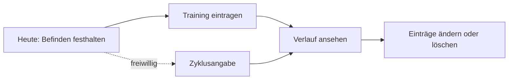

# Lösungsentwurf · Unser kurzes Pflichtenheft

**Vorschlag vom 18.11.2026. Noch keine beschlossene Technik.** Die [Anforderungen](02-lastenheft.md) sagen, was wir brauchen. Hier zeigen wir, wie die Lösung aussehen könnte.

## Unser Ablauf als Bild

Das ist eine einfache Ablaufskizze, kein UML-Use-Case-Diagramm. Eine eigene, im Team geprüfte Skizze oder Bildschirmzeichnung ergänzen wir in `design/`.

## Drei einfache Ansichten

- **Heute:** Datum, Energie von 1 bis 5 und eine freiwillige Zyklusangabe.
- **Training:** Datum, Sportart und Dauer. Speichern oder abbrechen.
- **Verlauf:** Einträge nach Datum mit Befinden und optionalen Zyklusangaben. Fehlende Werte bleiben erkennbar.

## Beispiel UC-01 · Tagesbefinden festhalten

Ein **Use Case** beschreibt einen konkreten Nutzungsfall. Bezug: F-01 / US-01.

1. Die Nutzerin öffnet „Heute“ und wählt einen Tag.
2. Sie wählt ihre Energie. Zyklusangaben darf sie weglassen.
3. Sie speichert. Die App prüft die Eingabe.
4. Bei Erfolg erscheint der Eintrag am gewählten Tag im Verlauf.

**Andere Fälle:** Fehlende Pflichtangaben erklären wir im Formular. Bei einem Speicherfehler zeigen wir keinen Erfolg an. Abbrechen legt nichts an. Nach dem vorgeschlagenen Eintragsmodell wird ein vorhandener Check-in geöffnet und geändert, statt einen zweiten anzulegen.

## Welche Daten brauchen wir?

| Eintrag | Felder im ersten Entwurf |
| --- | --- |
| Tagesbefinden | ID, lokales Datum, Energie 1–5 |
| Zyklusangabe | ID, lokales Datum, freiwillige Angabe zu beobachteter Blutung |
| Training | ID, lokales Datum, Sportart, Dauer in ganzen Minuten |

Die Eingaberegeln stehen gesammelt im Lastenheft. „Keine Angabe“ und der Wert „nein“ sind verschieden. Ein Account ist noch nicht eingeplant.

## Was wir technisch noch klären

Sprache und Oberfläche wählen wir nach unseren Kenntnissen und dem Aufwand. Bei der Speicherung vergleichen wir Browser-Speicher und ein Backend. Brauchen wir Gerätewechsel? Was passiert bei gelöschten Browserdaten? Wie funktionieren Zugriff und Löschung? Die Entscheidung halten wir in [Technik](11-technologie-und-ki.md) und [Entscheidungen](entscheidungen.md) fest.

Oberfläche, Eingaberegeln und Speicherung sollen getrennt bleiben. MVC und weitere Muster können dabei helfen, falls sie zur gewählten Technik passen. Weitere UML-Diagramme erstellen wir bei einer konkreten offenen Frage. Eine externe API braucht der erste manuelle Ablauf nicht.

Anforderung → Story → Prüfung ist im [Backlog](04-user-stories.md) und im [Testplan](07-erhebung-und-qualitaet.md) verknüpft. Programmieren beginnen wir laut bisheriger Mitschrift nach der Vorstellung.
