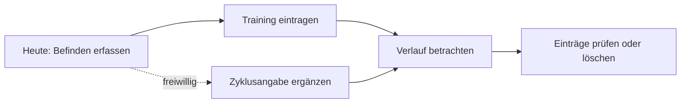

# Pflichtenheft · Lösungsentwurf

**Status: Entwurf v0.1, keine beschlossene Architektur.** Dieses Dokument wird nach der Bedarfsklärung konkretisiert. Kein Framework, Backend oder externer Dienst wurde eingerichtet.

## Lösungsidee

Eine mobil nutzbare Web-App zeigt drei Bereiche: **Heute**, **Training**, **Verlauf**. Eine installierbare PWA ist das Zielbild; die konkrete technische Auswahl hängt von Teamkenntnissen und Anforderungen ab. Der initiale Papier- oder Klickprototyp benötigt keine API.

Dies ist ein Nutzerablauf, kein UML-Use-Case-Diagramm.

## Beispiel Use Case UC-01 · Tagesbefinden erfassen

Bezug: F-01 / US-01. Akteurin: Nutzerin. Vorbedingung: Tagesansicht ist geöffnet. Auslöser: Sie möchte ihr Befinden dokumentieren.

1. Die Nutzerin wählt einen Tag.
2. Sie wählt ihre Energie auf einer vorläufigen Skala von 1 bis 5; die Bedeutung der Endpunkte ist sichtbar.
3. Sie ergänzt optional Angaben, deren genaue Auswahl noch zu klären ist.
4. Das System prüft die Eingabe und bestätigt das Speichern.
5. Der Eintrag erscheint für den gewählten Tag im Verlauf.

Alternativen: Bei ungültiger Eingabe bleibt das Formular offen und erklärt den Fehler. Ein Abbruch speichert nichts. Bei bestehendem Check-in für den Tag ist vor Umsetzung zu entscheiden, ob Bearbeitung oder mehrere Einträge unterstützt werden. Im ersten Entwurf schlagen wir genau einen bearbeitbaren Tages-Check-in vor.

Nachbedingung: Ein gültiger Eintrag ist gespeichert und wieder auffindbar. Für den Klickprototyp wird dieser Zustand nur simuliert und entsprechend bezeichnet.

## Vorläufiges Datenmodell

| Objekt | Minimale Felder | Noch zu entscheiden |
| --- | --- | --- |
| Tages-Check-in | ID, lokales Datum, Energie 1–5, optionale Befindensangabe | Auswahlwerte, Bearbeitung, Zeitbezug |
| Zyklusangabe | ID, lokales Datum, freiwillige beobachtete Angabe | Welche Angaben bringen im Alltag Nutzen? Keine automatische Phasenbestimmung vorgesehen |
| Trainingseinheit | ID, Datum, Sportart, Dauer in Minuten, optionale empfundene Anstrengung | Reicht dies oder braucht die Zielgruppe Sätze/Gewichte? |

Fehlende Angaben und der Wert null sind verschieden. Datums- und Skalenregeln werden vor Implementierung festgelegt. Account und Personenprofil sind keine automatisch vorausgesetzten Datenobjekte.

## Architekturentscheidungen vorbereiten

| Frage | Optionen | Entscheidungskriterium / nächster Schritt |
| --- | --- | --- |
| Oberfläche | Teamvertrautes Web-Framework; Kandidat Vite mit PWA-Plugin | Kenntnisse aller vier Personen, mobile Bedienung, Testbarkeit |
| Speicherung | Lokal im Browser oder Backend mit Account | Gerätewechsel notwendig? Löschung? Datenverlust? Aufwand? |
| Übungsdaten | Eigene kleine Auswahl oder externer Katalog | Benötigt US-03 überhaupt einen Katalog? Lizenz und Datenqualität prüfen |
| Health-Daten | Manuelle Eingaben zuerst, native Anbindung später | PWA-Kern muss ohne HealthKit/Flo funktionieren |

Für Visualisierung und optionale Prototypen vor M1 verwenden wir synthetische Daten. Die erste Implementierungsiteration folgt laut Mitschrift nach der Vorstellung gegen Semesterende. Falls das Team danach eine lokale Speicherung auswählt, muss es deren Grenzen erläutern: Löschen der Browserdaten kann Daten entfernen, Gerätesynchronisation entsteht dadurch nicht. Ein Backend benötigt ein eigenes Zugriffs- und Datenkonzept. Die Auswahl wird als Entscheidung protokolliert.

Oberfläche, fachliche Regeln und Speicherung sollen getrennt gedacht werden; ob MVC oder eine andere Struktur geeignet ist, entscheiden wir anhand des gewählten Frameworks. Es ist noch keine MVC-Implementierung vorhanden.

## Rückverfolgbarkeit und Abnahme

| Anforderung | Story | Entwurf | Abnahmetest |
| --- | --- | --- | --- |
| F-01, Q-04 | US-01 | UC-01, Tages-Check-in | AT-01, AT-08 |
| F-02, Q-01 | US-02 | Freiwillige Zyklusangabe | AT-02 |
| F-03 | US-03 | Trainingseinheit | AT-03 |
| F-04, Q-05 | US-04 | Verlauf | AT-04 |
| F-05 | US-05 | Einzel- und Gesamtlöschung | AT-05 |
| F-06 | US-06 | Installationsablauf | AT-06 |
| Q-02 | alle Kernstories | Mobile Formulare | AT-07 |
| Q-03 | alle Demonstrationen | Künstlicher Datensatz | Datenprüfung |

Details und Status der Tests stehen in [Erhebung und Qualität](07-erhebung-und-qualitaet.md). Vor der Implementierung ergänzt das Team hier Architektur, Datenflüsse, ausgewählte Versionen und Schnittstellen. Eine Integration gilt erst nach einem nachvollziehbaren Versuch als technisch bestätigt.
