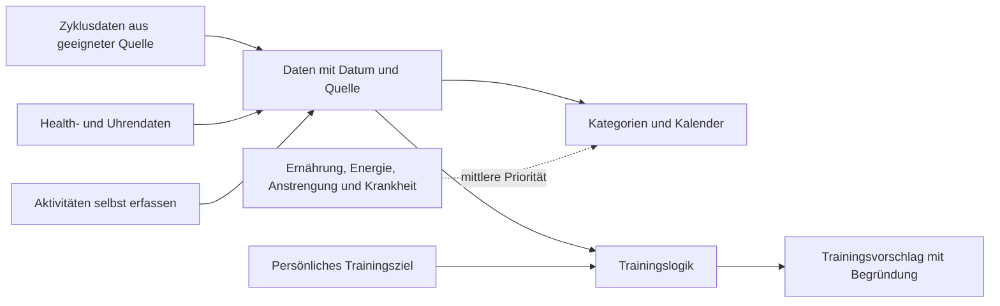
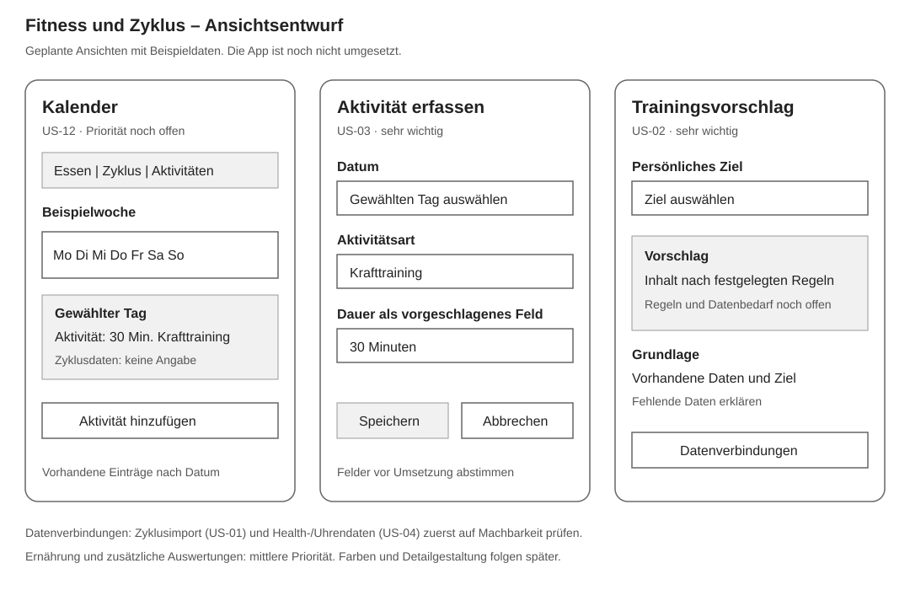

[Übersicht](../README.md) · [Ziele](01-motivation-und-ziele.md) · [Anforderungen](02-anforderungen.md) · [Backlog](03-product-backlog.md) · [Entwurf](04-entwurf.md) · [Technik](05-technik.md) · [Organisation](06-organisation.md) · [Vorstellung](07-projektvorstellung.md)

# Entwurf

Dies ist der erste Entwurf für unser kurzes **Pflichtenheft**: Wie könnten wir die [Anforderungen](02-anforderungen.md) umsetzen? Die Ansichten und Verbindungen sind geplant, noch nicht implementiert.

## Produktübersicht als Bild

Das Bild zeigt die Produktidee. Ob eine konkrete externe Quelle verfügbar ist, wird gesondert geprüft. Der folgende Ansichtsentwurf zeigt die geplanten Hauptbereiche.

## Geplante Ansichten

| Ansicht | Inhalt | Bezug |
| --- | --- | --- |
| Übersicht und Kalender | Einträge für einen gewählten Tag, Wechsel zwischen Essen, Zyklus und Aktivitäten | US-12 |
| Aktivitäten | Training erfassen und bisherige Aktivitäten ansehen | US-03 |
| Trainingsvorschläge | Persönliches Ziel und Vorschlag mit erkennbarer Grundlage | US-02 |
| Datenverbindungen | Unterstützte Quellen und Freigaben | US-01, US-04 |

Ernährung und zusätzliche Graphen ergänzen den Entwurf entsprechend ihrer Priorität. Anmeldung und Kontoverwaltung hängen von der noch offenen Speicherentscheidung ab.

## Beispielablauf Aktivität erfassen

1. Die Nutzerin öffnet den Bereich Aktivitäten.
2. Sie ergänzt die vereinbarten Angaben, zum Beispiel Datum, Aktivitätsart und Dauer.
3. Die App prüft die Eingabe und speichert sie.
4. Der Eintrag ist beim passenden Datum wieder sichtbar.

Bei ungültigen Angaben gibt es einen verständlichen Hinweis. Abbrechen legt nichts an. Ein Speicherfehler darf nicht wie ein erfolgreicher Eintrag aussehen. Bezug: [US-03 · Aktivitäten festhalten](https://github.com/al3v4l3/cycle-activity-project/issues/16), Q-01 und Q-03.

## Daten im ersten Entwurf

| Bereich | Vorgesehene Angaben |
| --- | --- |
| Aktivität | Datum, Aktivitätsart, Dauer als erste Mindestfelder; weitere Messwerte offen |
| Übernommene Daten | Wert bzw. Eintrag, Datum, Datenart und Quelle; konkret verfügbare Felder prüfen |
| Trainingsziel | Persönliches Ziel; Auswahlmöglichkeiten noch festlegen |
| Vorschlag | Ergebnis und verwendete Grundlage |
| Selbsteinschätzung | Datum, Energie und Anstrengung jeweils 1 bis 10 |
| Weitere Einträge | Ernährung, Krankheit oder manuelle Zyklusangaben je nach gewähltem Umfang |

Speicherort, Kontozuordnung und Löschung werden mit der Technikauswahl konkretisiert. Die Oberfläche, die Trainingslogik, die Datenanbindung und die Speicherung sollen getrennte Aufgabenbereiche bleiben.

## Spätere Umsetzung

Vor dem App-Code wählen wir einen kleinen durchgängigen Ablauf und klären seine Abhängigkeiten. Die Anbindung einer Datenquelle und eine regelbasierte Empfehlung müssen zunächst mit Beispielen prüfbar beschrieben sein. Code und ausführbare Tests kommen später in dasselbe Repository.
